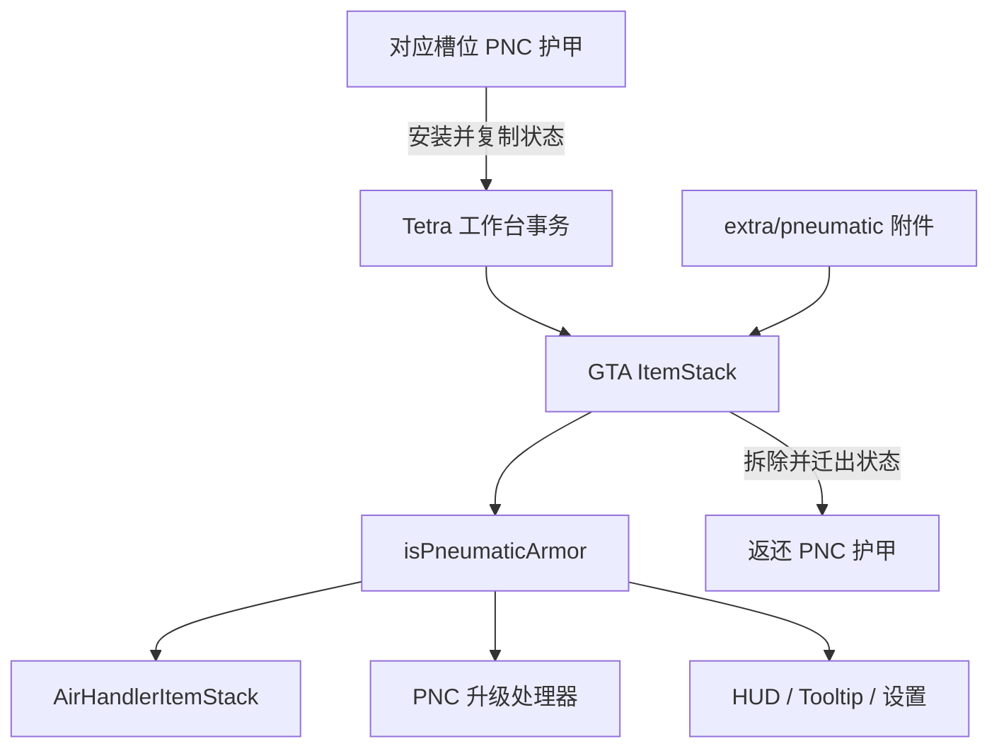

# GeoTetraArmor PneumaticCraft Compat 项目索引

> 面向维护者的源码导航。`build/` 与 `run/` 是生成或运行目录，不应作为实现依据。

## 1. 项目定位

本项目将 PneumaticCraft: Repressurized（PNC）6.0.23 的气动护甲作为 GeoTetraArmor（GTA）6.9.0-1.0.5 的 Tetra 附件实现，运行于 Minecraft 1.20.1、Forge 47.3.29 和 Java 17。

只有在固定额外槽位安装对应模块的 GTA 护甲才是气动护甲：

| 身体槽位 | Tetra 槽位 | 模块键 | 安装材料 |
| --- | --- | --- | --- |
| 头部 | `head/extra` | `armor/head/extra/pneumatic` | `pneumaticcraft:pneumatic_helmet` |
| 胸部 | `chest/extra` | `armor/chest/extra/pneumatic` | `pneumaticcraft:pneumatic_chestplate` |
| 腿部 | `legs/extra` | `armor/legs/extra/pneumatic` | `pneumaticcraft:pneumatic_leggings` |
| 脚部 | `feet/extra` | `armor/feet/extra/pneumatic` | `pneumaticcraft:pneumatic_boots` |

核心约束：

1. `GeoTetraArmorItems.isPneumaticArmor(ItemStack)` 是 capability、充能、升级、效果、网络、HUD 和 tooltip 的统一栈级门禁。
2. PNC 升级数据库只能按物品注册，四件 GTA 物品因此进入白名单；实际行为仍按附件动态放行。
3. 安装附件时从消耗的对应 PNC 护甲继承气量、升级和设置；拆除或替换时返还对应 PNC 护甲并迁回当前状态。
4. 复用 PNC 原处理器、公式、状态跟踪和网络包，不重写平衡数值。
5. 不处理旧版 GTA 栈中的 PNC NBT 清理或兼容迁移。

依赖和开发运行项见 [build.gradle](build.gradle)，版本及模组身份见 [gradle.properties](gradle.properties)，运行时依赖见 [mods.toml](src/main/templates/META-INF/mods.toml)。

## 2. 建议阅读顺序

1. [GeoTetraArmorItems.java](src/main/java/com/yi_ran/geotetraarmor_pnc/api/GeoTetraArmorItems.java)：物品、身体槽位、附件模块和对应 PNC 护甲的统一映射。
2. [GeoTetraArmorMixin.java](src/main/java/com/yi_ran/geotetraarmor_pnc/compat/pneumaticcraft/GeoTetraArmorMixin.java)：气压 capability、PNC 接口、属性和特殊行为。
3. [WorkbenchTileMixin.java](src/main/java/com/yi_ran/geotetraarmor_pnc/compat/pneumaticcraft/WorkbenchTileMixin.java) 与 [PneumaticArmorState.java](src/main/java/com/yi_ran/geotetraarmor_pnc/pneumatic/PneumaticArmorState.java)：安装/拆除事务和状态迁移。
4. [GeoTetraArmorPnc.java](src/main/java/com/yi_ran/geotetraarmor_pnc/GeoTetraArmorPnc.java)：升级数据库注册和附件限定 tooltip。
5. [geotetraarmor_pnc.mixins.json](src/main/resources/geotetraarmor_pnc.mixins.json)：14 个通用 Mixin 和 10 个客户端 Mixin。

## 3. 运行链路



`GeoTetraArmorItems` 从 GTA 的 `IModularItem` 读取对应 `*/extra` 槽中的 `ItemModule`，并精确比较模块键。`GeoTetraArmorPnc` 在 `FMLLoadCompleteEvent` 后把四件 GTA 物品注册到 PNC 的 `ApplicableUpgradesDB`；这只满足 PNC 的 item-based API，不放宽栈级门禁。

`BaseSchematicMixin` 拒绝重复安装。`WorkbenchTileMixin` 在 `WorkbenchTile#craft(Player)` 前后比较附件状态：`false -> true` 从对应 PNC 材料复制状态；`true -> false` 新建对应 PNC 护甲、迁回状态并加入背包，背包满则掉落。

`PneumaticArmorState` 只处理 PNC 气量、升级库存、创造标记、搜索/坐标/过滤、跳跃/速度/喷气靴设置和三个 PNC 颜色键。`UpgradeCache` 在来源和目标上失效；耐久、附魔、名称和 Lore 不迁移。

`GeoTetraArmorMixin` 实现 `IPressurizableItem`、`IFOVModifierItem` 和 `ICustomDurabilityBar`。每个 GTA 栈都挂载 `PneumaticArmorCapabilityProvider`，但只有附件存在时才暴露 AIR capability，且气压处理器按需惰性创建。容量、FOV 和压力耐久条委托对应槽位的原版 PNC 护甲；护甲升级按 PNC 公式追加每级 `+0.5` 护甲和 `+1` 韧性，并接入镀金、末影面具、脚蹼和鞘翅飞行；损坏（broken）状态下不追加护甲升级属性。创造升级的“不可损耗”由 `ItemModularHandheldMixin` 注入 Tetra 的 `isDamageable`，不得在 `GeoTetraArmorMixin` 中声明同签名方法覆盖 Tetra 实现。

## 4. 源码索引

### 4.1 入口、API 与状态

| 文件 | 职责 |
| --- | --- |
| [GeoTetraArmorPnc.java](src/main/java/com/yi_ran/geotetraarmor_pnc/GeoTetraArmorPnc.java) | Forge 入口、升级白名单、附件限定 tooltip。 |
| [GeoTetraArmorItems.java](src/main/java/com/yi_ran/geotetraarmor_pnc/api/GeoTetraArmorItems.java) | GTA/附件/槽位/PNC 护甲映射和统一门禁。 |
| [IPneumaticArmorCompat.java](src/main/java/com/yi_ran/geotetraarmor_pnc/api/IPneumaticArmorCompat.java) | 注入 GTA 物品的语义标记；实际门禁不依赖该接口。 |
| [PneumaticArmorState.java](src/main/java/com/yi_ran/geotetraarmor_pnc/pneumatic/PneumaticArmorState.java) | 选择性复制或迁移 PNC 状态并失效升级缓存；比较两件护甲的 PNC 配置（忽略气量）。 |
| [PneumaticArmorCapabilityProvider.java](src/main/java/com/yi_ran/geotetraarmor_pnc/pneumatic/PneumaticArmorCapabilityProvider.java) | 附件限定、惰性创建的 AIR capability。 |

### 4.2 通用端 Mixin

| 文件 | 目标或职责 |
| --- | --- |
| [BaseSchematicMixin.java](src/main/java/com/yi_ran/geotetraarmor_pnc/compat/pneumaticcraft/BaseSchematicMixin.java) | 拒绝重复安装。 |
| [WorkbenchTileMixin.java](src/main/java/com/yi_ran/geotetraarmor_pnc/compat/pneumaticcraft/WorkbenchTileMixin.java) | 安装和拆除状态事务。 |
| [GeoTetraArmorMixin.java](src/main/java/com/yi_ran/geotetraarmor_pnc/compat/pneumaticcraft/GeoTetraArmorMixin.java) | PNC 接口、capability、属性和特殊行为。 |
| [ItemModularHandheldMixin.java](src/main/java/com/yi_ran/geotetraarmor_pnc/compat/pneumaticcraft/ItemModularHandheldMixin.java) | 在 Tetra `isDamageable` 上叠加 PNC 创造升级，其余保持 Tetra 耐久逻辑。 |
| [NightVisionHandlerMixin.java](src/main/java/com/yi_ran/geotetraarmor_pnc/compat/pneumaticcraft/NightVisionHandlerMixin.java) | 头盔未装夜视升级时，关闭夜视开关不再清除玩家的夜视效果。 |
| [PneumaticArmorItemMixin.java](src/main/java/com/yi_ran/geotetraarmor_pnc/compat/pneumaticcraft/PneumaticArmorItemMixin.java) | PNC 静态护甲判断、配置读写和无人机调试门禁。 |
| [CommonArmorHandlerMixin.java](src/main/java/com/yi_ran/geotetraarmor_pnc/compat/pneumaticcraft/CommonArmorHandlerMixin.java) | 放行附件护甲的每槽位升级处理。 |
| [PneumaticArmorHandlerMixin.java](src/main/java/com/yi_ran/geotetraarmor_pnc/compat/pneumaticcraft/PneumaticArmorHandlerMixin.java) | 放行附件护腿的跳跃增强和附件喷气靴的追踪同步。 |
| [ScubaHandlerMixin.java](src/main/java/com/yi_ran/geotetraarmor_pnc/compat/pneumaticcraft/ScubaHandlerMixin.java) | 兼容头盔基础容量的硬转换。 |
| [JetBootsHandlerMixin.java](src/main/java/com/yi_ran/geotetraarmor_pnc/compat/pneumaticcraft/JetBootsHandlerMixin.java) | 把冷却写到实际 GTA 靴子物品。 |
| [LivingEntityArmorMixin.java](src/main/java/com/yi_ran/geotetraarmor_pnc/compat/pneumaticcraft/LivingEntityArmorMixin.java) | 气动件之间直接替换且 PNC 配置不同时重置槽位处理器；同一件护甲的槽位同步（Curios、机器界面）不重置。 |
| [PacketUpdateArmorExtraDataMixin.java](src/main/java/com/yi_ran/geotetraarmor_pnc/compat/pneumaticcraft/PacketUpdateArmorExtraDataMixin.java) | 放行附件护甲的设置数据包。 |
| [PacketUpdateSearchItemMixin.java](src/main/java/com/yi_ran/geotetraarmor_pnc/compat/pneumaticcraft/PacketUpdateSearchItemMixin.java) | 放行附件头盔的搜索目标数据包。 |
| [ChargingStationBlockEntityMixin.java](src/main/java/com/yi_ran/geotetraarmor_pnc/compat/pneumaticcraft/ChargingStationBlockEntityMixin.java) | 服务端充能库存和升级管理入口（`CHARGING_ARMOR` 护甲专用界面）。 |

### 4.3 客户端 Mixin

| 文件 | 目标或职责 |
| --- | --- |
| [AbstractUpgradeManagerScreenAccessor.java](src/main/java/com/yi_ran/geotetraarmor_pnc/compat/pneumaticcraft/AbstractUpgradeManagerScreenAccessor.java) | 暴露升级界面的物品栈。 |
| [ChargingStationScreenMixin.java](src/main/java/com/yi_ran/geotetraarmor_pnc/compat/pneumaticcraft/ChargingStationScreenMixin.java) | 附件限定的管理升级按钮。 |
| [CoreComponentsClientHandlerMixin.java](src/main/java/com/yi_ran/geotetraarmor_pnc/compat/pneumaticcraft/CoreComponentsClientHandlerMixin.java) | 核心组件 HUD 的附件识别。 |
| [HUDHandlerMixin.java](src/main/java/com/yi_ran/geotetraarmor_pnc/compat/pneumaticcraft/HUDHandlerMixin.java) | 附件头盔 HUD 的眼部颜色。 |
| [PneumaticArmorHUDOverlayMixin.java](src/main/java/com/yi_ran/geotetraarmor_pnc/compat/pneumaticcraft/PneumaticArmorHUDOverlayMixin.java) | 压力条与初始化进度渲染。 |
| [PneumaticElytraLayerMixin.java](src/main/java/com/yi_ran/geotetraarmor_pnc/compat/pneumaticcraft/PneumaticElytraLayerMixin.java) | 附件胸甲的 PNC 鞘翅层。 |
| [PneumaticArmorUpgradeScreenMixin.java](src/main/java/com/yi_ran/geotetraarmor_pnc/compat/pneumaticcraft/PneumaticArmorUpgradeScreenMixin.java) | 专用升级界面的类型与容量兼容（以对应 PNC 护甲提供说明文本和槽位）。 |
| [ItemSearcherScreenMixin.java](src/main/java/com/yi_ran/geotetraarmor_pnc/compat/pneumaticcraft/ItemSearcherScreenMixin.java) | 物品搜索器界面不再因附件头盔自动关闭。 |
| [CoordTrackClientHandlerMixin.java](src/main/java/com/yi_ran/geotetraarmor_pnc/compat/pneumaticcraft/CoordTrackClientHandlerMixin.java) | 附件头盔可右键选取坐标追踪目标。 |
| [AreaRenderManagerMixin.java](src/main/java/com/yi_ran/geotetraarmor_pnc/compat/pneumaticcraft/AreaRenderManagerMixin.java) | 附件头盔的无人机调试区域渲染。 |

## 5. 资源索引

| 文件或目录 | 用途 |
| --- | --- |
| [geotetraarmor_pnc.mixins.json](src/main/resources/geotetraarmor_pnc.mixins.json) | Mixin 装配、refmap 和注入器约束。 |
| [head module](src/main/resources/data/tetra/modules/armor/head/extra/pneumatic.json) / [chest module](src/main/resources/data/tetra/modules/armor/chest/extra/pneumatic.json) / [legs module](src/main/resources/data/tetra/modules/armor/legs/extra/pneumatic.json) / [feet module](src/main/resources/data/tetra/modules/armor/feet/extra/pneumatic.json) | 四个身份/状态附件模块。 |
| [head schematic](src/main/resources/data/tetra/schematics/armor/head/extra/pneumatic.json) / [chest schematic](src/main/resources/data/tetra/schematics/armor/chest/extra/pneumatic.json) / [legs schematic](src/main/resources/data/tetra/schematics/armor/legs/extra/pneumatic.json) / [feet schematic](src/main/resources/data/tetra/schematics/armor/feet/extra/pneumatic.json) | 消耗对应 PNC 护甲的工作台方案。 |
| [en_us.json](src/main/resources/assets/geotetraarmor_pnc/lang/en_us.json) / [zh_cn.json](src/main/resources/assets/geotetraarmor_pnc/lang/zh_cn.json) | 模块、方案和材料槽本地化。 |
| [pack.mcmeta](src/main/templates/pack.mcmeta) | 构建时展开的 1.20.1 资源包元数据。 |

## 6. 构建与验收

```powershell
.\gradlew.bat compileJava
.\gradlew.bat processResources
.\gradlew.bat build
.\gradlew.bat runClient
```

- 构建产物位于 `build/libs/`，开发实例位于 `run/`。
- Mixin 编译成功不证明运行时注入点存在；依赖更新后必须检查实际应用日志。
- 最终验收必须启动客户端并进入世界。至少验证四个附件的安装、状态继承、充气、升级管理、穿戴效果、HUD/tooltip、设置修改和拆除返还。
- `runServer`、`runGameTestServer` 或客户端只到主菜单不构成完整验收。

## 7. 修改检查点

1. 新入口必须调用 `isPneumaticArmor(ItemStack)`，不能只判断 GTA 物品、类型或升级 NBT。
2. 状态事务只迁移 PNC 自有键，必须失效 `UpgradeCache`，不得复制通用物品元数据。
3. 普通辅助类不能放入 `geotetraarmor_pnc.mixins.json` 声明的 `compat.pneumaticcraft` Mixin 包。
4. 临时返回 PNC 护甲只能满足局部类型判断或强转，状态操作必须继续作用于原 GTA 栈。
5. 更新依赖后需以准确字节码核对每个 `@Redirect` 的方法边界和调用数量。
6. 界面/HUD Mixin 留在 `client` 数组；通用逻辑留在 `mixins` 数组。
7. 不增加旧 GTA 栈的历史 PNC NBT 扫描、迁移或清理。
8. 不在 `GeoTetraArmorMixin` 中声明 Tetra 继承链已有的方法（如 `isDamageable`）；需要改变行为时注入 Tetra 原方法，保证未装附件的护甲保持 Tetra 原行为。
9. 挂在 `onEquipItem` 等会被槽位同步反复调用的入口上的逻辑，必须区分“同一件护甲重新同步”和“真正换装”。
10. Tetra 工作台会在客户端预测执行 `craft`，发放物品等副作用只能在服务端执行。
11. 不在运行期创建 `Item` 实例；需要“伪装类型”时返回对应的已注册 PNC 物品。
